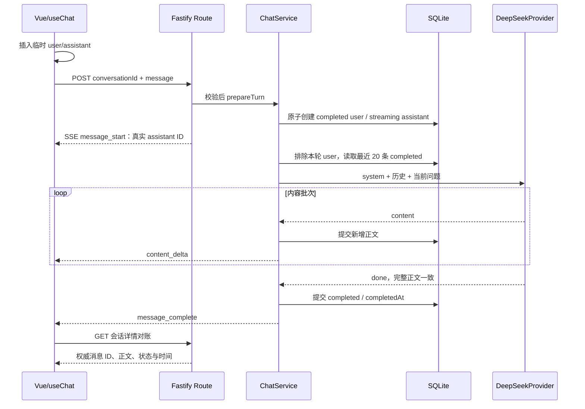
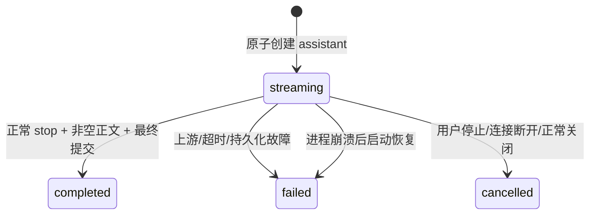

# 一期开发文档：Feature 01

基线日期：2026-11-15。项目目录：`health-ai/`。本文描述已经实现并验收的代码；用于理解技术细节及下一阶段维护，不新增需求。

快速接续开发先读 [NEXT_PHASE_CONTEXT.md](NEXT_PHASE_CONTEXT.md)；按需回到本文。执行历史见 [WORK_PLAN.md](../WORK_PLAN.md)，逐项验收见 [ACCEPTANCE.md](ACCEPTANCE.md)，设计取舍见 [DECISIONS.md](DECISIONS.md)。

## 1. 交付范围与基线

一期完成桌面 Web 健康知识聊天 MVP：会话新建/列表/切换/删除、流式模型回复、最近历史上下文、停止生成、刷新恢复、Markdown/代码高亮、滚动跟随及异常恢复。

P0–P6、A01–A21 已全部通过：105/105 自动化测试，类型检查、生产构建、锁文件一致性检查通过。最终 P6 报告时间 `2026-11-15T09:54:54.464Z`，11 项检查通过、59 个来源哈希一致。真实 DeepSeek 和人工 UI 验收在 P2/P4/P5 完成。

范围为本机、单进程、无账号的桌面应用。尚未实现：用户鉴权/权限、健康档案、诊疗决策、RAG/知识库、工具调用/Agent、自动标题、附件、消息编辑/重生成、移动端、分页、分布式任务与生产部署方案。下一阶段需求尚未确定，不能把这些候选方向当成已授权任务。

## 2. 技术栈与工程组织

| 层级 | 当前选择 | 作用 |
| --- | --- | --- |
| 运行环境 | Node 22，最低 22.12；pnpm 10.26.0 | workspace、Node 内置环境加载与测试运行器 |
| 前端 | Vue 3.5、TypeScript 5、Pinia 3、Router 4 | 组件、类型、公共状态、路由 |
| UI/构建 | Element Plus 2、Vite 7 | 按需组件与前端构建 |
| 后端 | Fastify 5、Zod 4、tsx 4 | HTTP、严格参数校验、执行 TS 源码 |
| 模型 | openai SDK 7（已验收 7.57.0）对接 DeepSeek | 标准 Provider 封装、流式调用、Abort |
| 数据 | better-sqlite3 12（已验收 12.11.1） | 同步 SQL、短事务、WAL |
| 渲染 | markdown-it 14、highlight.js 11 | HTML 关闭的 Markdown、8 种语言高亮 |

实际依赖解析以 `pnpm-lock.yaml` 为准，package.json 的版本范围不等于实装版本。自动导入插件固定为 21.1.0/32.1.0，无新增测试框架依赖。

```text
apps/server/src/
  index.ts                    配置、真实 Provider、监听端口与信号退出
  app.ts                      buildApp、统一错误、恢复、关闭钩子
  config/env.ts               项目根定位、环境加载与校验
  database/{db.ts,schema.sql}  连接、PRAGMA、两表 schema
  modules/chat/
    chat.route.ts             REST/SSE、参数校验与响应接管
    chat.service.ts           任务锁、上下文、批次、超时、终态
    chat.repository.ts        消息/会话 SQL 与事务
  common/{errors.ts,sse.ts}    安全错误、SSE writer/背压
  providers/                  ModelProvider 与 DeepSeek 实现
  prompts/system.ts           健康助手 system prompt
apps/web/src/
  views/ChatView.vue          页面初始化与双栏组装
  components/chat/            侧栏、输入、消息列表、消息渲染
  stores/chat.ts              六个公共 Store 字段
  composables/useChat.ts      控制器、乐观消息、取消、对账与竞态
  composables/useSseParser.ts 跨 chunk SSE 解析
  composables/useAutoScroll.ts 滚动策略
  api/chat.ts                 REST、fetch 流、UTF-8/协议验证
  utils/markdown.ts           私有安全渲染器
packages/shared/src/          TS 类型、事件、错误常量
scripts/                     分阶段验收工具
```

依赖方向为 `Route → Service → Repository / Provider`；SQL 集中在 Repository，数据库初始化 DDL 位于 database。前端不接触模型 Key。`shared` 零运行依赖，exports 指向 TS 源码，通过 workspace 引用，没有独立 build。后端使用 tsx 执行源码，根 `build` 不输出可独立运行的 server JS 包。

## 3. 一次发送如何完成



`prepareTurn` 在首次 await 前检查存在性、同会话占用和 Provider，并完成短事务/任务占位。同一会话未收尾返回 409；不同会话可以各自生成。锁是 `ChatService` 内存 Map，作用域只有当前进程。

批次条件为 **75ms 或累计未提交内容达到 1024 UTF-8 字节**。等待上游时也能由时间条件刷新。Service 同时最多保留一个上游 `next()` 在途，不为了计时刷新而重复读取 iterator。

最关键约束是：**DB 提交成功后才发 content_delta，最终状态提交后才发 complete**。浏览器已收到的片段应能从正常工作的 SQLite 恢复。socket 背压不累积发送队列，但 Service 和 Provider 仍保存本轮全文；这不是全链路恒定内存实现。

## 4. HTTP 与 SSE 契约

### 4.1 REST

| 方法/路径 | 输入 | 成功响应 |
| --- | --- | --- |
| `POST /api/conversations` | 无 body 或 `{}` | 201，`{ conversation }` |
| `GET /api/conversations` | 无 query | 200，`{ conversations }` |
| `GET /api/conversations/:id` | 非空 ID | 200，`{ conversation, messages }` |
| `DELETE /api/conversations/:id` | 无 body 或 `{}` | 200，`{ ok: true }` |
| `POST /api/chat/stream` | `{ conversationId, message }` | 200，SSE |

路由拒绝未知 query/body/params 字段；stream 的两个值均 trim，非空，message 最大长度 8000。ID 校验非空，不要求 UUID 正则。Fastify bodyLimit 为 128KiB。不存在的会话和重复删除返回 404；生成中的会话不可删除，返回 409。

前端生成请求只发送本轮问题与 conversationId，历史和 system prompt 由服务端生成。没有独立 stop、非流式 chat 或 title 更新接口。

### 4.2 SSE

响应头：`text/event-stream; charset=utf-8`、`cache-control: no-cache`、`connection: keep-alive`、`x-accel-buffering: no`。帧格式为 `event: 名称\ndata: JSON\n\n`。

| 事件 | data | 语义 |
| --- | --- | --- |
| `message_start` | `{ messageId }` | 真实 assistant ID，替换临时 ID |
| `content_delta` | `{ delta }` | 已提交 DB 的新增正文，追加显示 |
| `message_complete` | `{ messageId }` | 成功终态，DB 已提交 |
| `message_error` | `{ code, message }` | 失败终态，安全错误 |
| `message_cancelled` | `{ messageId }` | 取消终态；断开的客户端未必能收到 |

心跳是每 15s 的注释 `: ping\n\n`，不算内容。前置参数/会话/忙/配置/初始 DB 错误使用 JSON + HTTP 状态，尚未进入 SSE；进入流后的错误使用 message_error，HTTP 已经是 200。

客户端使用 fetch POST + ReadableStream，避免 EventSource 的 GET 限制；TextDecoder 以流模式处理 UTF-8，再按跨 chunk 的 LF/CRLF 行解析 SSE。终止事件后立即取消 reader，不等待远端 EOF；无终止事件的 EOF、非法 JSON、事件顺序/消息 ID 不一致均视为失败。message_error 的文案由本地错误表映射，不展示任意上游字符串。

### 4.3 固定错误表

| code | HTTP（前置 JSON 时） | 默认文案 |
| --- | --- | --- |
| INVALID_PARAM | 400 | 输入有误，请检查后重试 |
| CONVERSATION_NOT_FOUND | 404 | 会话不存在或已删除 |
| CONVERSATION_BUSY | 409 | 当前会话正在生成回答 |
| CONFIG_ERROR | 500 | 服务配置异常，请联系管理员 |
| RATE_LIMITED | 429 | 请求过于频繁，请稍后重试 |
| UPSTREAM_TIMEOUT | 504 | 生成超时，请重试 |
| UPSTREAM_ERROR | 502 | 模型服务异常，请稍后重试 |
| INTERNAL_ERROR | 500 | 服务异常，请重试 |

JSON 错误形状为 `{ code, message }`。不附加原始 Error、cause、headers、上游 body。

## 5. 数据模型、事务与历史上下文

| 表 | 字段与约束 |
| --- | --- |
| conversations | `id TEXT PK`；`title TEXT NOT NULL DEFAULT '新对话'`；`created_at/updated_at INTEGER NOT NULL` |
| messages | `id TEXT PK`；`conversation_id TEXT NOT NULL FK → conversations(id) ON DELETE CASCADE`；`role TEXT user/assistant`；`content TEXT NOT NULL`；`status TEXT pending/streaming/completed/failed/cancelled`；`model TEXT NULL`；`created_at INTEGER NOT NULL`；`completed_at INTEGER NULL` |

索引 `idx_messages_conversation(conversation_id, created_at)`。ID 为应用生成的 UUID；时间为毫秒。对外映射为 camelCase：`createdAt`、`updatedAt`、`conversationId`、`completedAt`。精确 TS 类型位于 shared。

连接设置：WAL、foreign_keys=ON、synchronous=FULL、busy_timeout=5000。schema 使用 `CREATE TABLE IF NOT EXISTS`，目前没有版本化迁移框架；下一阶段改表必须设计已有数据升级方案，修改 CREATE TABLE 不会自动迁移旧库。

| 方法 | 保证 |
| --- | --- |
| `createTurn` | 同事务插入 completed user 与空 streaming assistant，并更新会话；失败整笔回滚 |
| `appendMessageContent` | 仅向 streaming assistant 追加正文，并更新会话时间 |
| `finalizeMessage` | 同事务追加未提交尾部、写终态/完成时间；只允许 pending/streaming，终态不能被迟到 close 覆盖 |
| `recoverInterruptedMessages` | 启动时 streaming assistant 改为 failed，保留正文并写 completedAt |
| `getMessages` | 所有状态，`created_at ASC, rowid ASC` |
| `getCompletedMessages` | 先排除本轮 user，再取最近 limit 条 completed，最后恢复时间/rowid 正序 |

会话列表按 `updated_at DESC, rowid DESC`；同毫秒不会随机排序。更新时间使用 MAX 防系统时钟回拨导致倒退。事务只包短 SQL，不跨上游网络等待。

上下文构成为 `system + 最近 20 条 completed 消息 + 本轮 user`，最多 22 条。**20 是消息条数，不是 20 轮；没有 token 预算裁剪或摘要。**失败/取消的 assistant 不进入模型历史，但对应 user 已是 completed，仍可能进入窗口；当前代码不做问答配对修补。全量详情仍返回所有状态，供 UI 恢复。

## 6. 终态、取消、背压与故障



user 创建即 completed。pending 保留在类型/schema 中，但正常发送流程不创建 pending。

- 用户停止：前端立即保留文字并显示 cancelled，然后 AbortController 断开 fetch。后端监听 **response close**，将 signal 传入 Provider；不能改为监听 request close，否则请求体读取完会误取消正常 SSE。
- 超时：Service 调用前开始 60s 内容空闲计时，只有非空 content 重置；reasoning 和 SSE 心跳不续期。timeout 为 failed + UPSTREAM_TIMEOUT。SDK 另有 60s 请求 timeout。
- 背压：`response.write()` 返回 false 后等待 drain；等待期间不继续消费上游，也不排队心跳。drain 最长 10s，超时断开并取消。
- 数据故障：先判定失败/取消原因，再主动 abort 上游，避免自发 abort 把错误误分类为 cancelled。批次写失败不发该 delta；尽力以 failed 提交尾部。完全无法写盘时只能保留此前提交前缀，遗留 streaming 待存储恢复后重启标 failed，不能承诺磁盘失效时零丢失。
- 完成竞态：DB completed 后设置 finalized；之后客户端关闭不再覆盖为 cancelled。finally 清 timer、abort、尝试 iterator.return、移除同一任务的 Map 项并 resolve settled。同步/异步 iterator 清理异常不能阻塞锁释放。
- 服务退出：Fastify preClose 先停止接收新的生成任务、abort 活动任务、等待 settled；onClose 再关 DB。SIGKILL 不走钩子，依赖已提交 WAL 与下次启动恢复。
- Header 异常：prepareTurn 已插入数据后若 writeHead 失败，仍以取消方式运行收尾、释放占位并销毁损坏响应。

## 7. Provider 的完成判据

`ModelProvider.chatStream(input)` 返回 AsyncIterable，输入为 model、system/user/assistant messages、可选 signal。内部事件只有 content、reasoning、done；Service 忽略 reasoning，不存库、不传浏览器。

DeepSeek 请求：默认 `deepseek-flash`、`stream:true`、顶层 `thinking:{type:'disabled'}`、`max_tokens:4096`，SDK `maxRetries:0`、logLevel off，organization/project 显式 null。没有 fallback 或自动重试。

Provider 只在收到 `finish_reason:'stop'`、正文非空且流正常结束时发 done，并检查取消信号。length/content_filter/tool_calls、截断 EOF、空回答、stop 后又出现 choice 内容等均失败，保留先前输出。仅有 usage 的空 choices 帧忽略。

401/403→CONFIG_ERROR；429→RATE_LIMITED；连接 timeout/408/504→UPSTREAM_TIMEOUT；其他网络/HTTP/协议故障→UPSTREAM_ERROR。调用方取消单独传播 AbortError。失败、取消或消费者提前退出时停止 SDK transport。

## 8. 前端状态与交互

Store 只有 `conversations/currentConversationId/messages/loading/generating/error` 六个字段。任务对象、controller、settled 和 viewVersion 在 useChat 控制器闭包中，不能随意挪成未约定的 Store 公共字段。

| 行为 | 实现 |
| --- | --- |
| 页面打开 | 读列表，切换到首项；无会话则新建；不自动调用模型 |
| 发送 | trim/长度/双发检查，插入两个 local UUID 乐观消息，start 绑定真实 assistant ID |
| 明确 HTTP 拒绝 | start 前收到非成功 JSON，删除本轮临时消息，保留已有历史 |
| 网络结果不确定 | 不重发 POST，保留已显示文字，GET 详情对账 |
| 收尾对账 | 最多 20 次 GET，仍 streaming 时约 100ms 间隔；以服务端 ID/状态/时间/正文覆盖临时数据；失败则保留本地文字提示刷新 |
| 切换/新建 | 先 abort 当前任务，等待 settled（含对账），再加载/创建；所有旧回调检查任务身份，GET 检查 viewVersion |
| 删除 | UI 确认；生成中的当前会话禁删，非当前会话可删且不取消当前流；删当前选列表首项，删最后一项保留空态 |

GET 轮询次数有限，但单次 REST fetch 目前没有业务级超时；网络永久挂起的处理属于未来可改进项，不能把 20 次轮询误写成严格 2s 总截止时间。

桌面布局最小宽度 900px、最大 1280px、侧栏 260px。标题固定“新对话”，时间/ID 末四位辅助辨认。Enter 发送、Shift+Enter 换行，composition/isComposing/keyCode229 防输入法选词误发。组件发出 send 后清输入框，目前无失败草稿自动恢复。

Markdown 渲染器私有，html=false、linkify=true、breaks=true；链接固定 target=_blank/rel=noopener noreferrer。只注册 javascript/typescript/json/bash/sql/python/xml/css，html 使用 xml；未知语言、未闭合 fence、高亮抛错安全回退转义。assistant 正文通过该渲染器生成 HTML，user 正文使用 Vue 文本插值保留换行。修改 ChatMessage.vue 渲染时保留恶意样本回归。

滚动跟随由 useAutoScroll 管理：离底部超过一屏暂停跟随并显示“回到底部”；回到底部或切换会话恢复。MessageList 在 DOM 更新后滚动，watch 清理避免旧 nextTick 干扰新视图。

## 9. 本地运行与配置

项目根两个终端分别运行 `pnpm dev:server`、`pnpm dev:web`。API 默认 `127.0.0.1:3000`；Web 固定 `127.0.0.1:5188`、strictPort，`/api` proxy 到配置的后端 PORT。不要无意恢复旧的前端端口。

| 环境项 | 默认/要求 |
| --- | --- |
| DEEPSEEK_API_KEY | 非空；只在本机 .env 配置，已有文件不能覆盖 |
| DEEPSEEK_BASE_URL | https://api.deepseek.com |
| DEEPSEEK_MODEL | deepseek-flash |
| PORT | 3000 |
| DATABASE_URL | ./data/health-ai.db |

env.ts 用 import.meta.url 定位项目根，Node process.loadEnvFile 加载根 .env，已有进程环境优先；相对 DB 路径按项目根解析。Vite 配置仅读取 PORT 用于代理，不通过 define/envPrefix 注入 Key。占位 Key 可启动应用，但 Provider 不配置，生成请求返回 CONFIG_ERROR；独立真实调用脚本也会前置拒绝占位值。

SQLite 为本地明文存储，无加密/账号隔离。不要把当前无鉴权接口直接扩展为公网服务。根 build 只构建 web，Fastify 当前也不负责托管静态产物；生产部署需另行确定静态托管、代理、密钥、权限和数据备份方案。备份活跃 WAL 数据库应使用 SQLite 一致性备份方式，不能只复制主 db 并忽略 WAL。

## 10. 验证命令与证据分工

| 命令 | 内容 | 真实模型调用 |
| --- | --- | --- |
| `pnpm check:scaffold` | workspace/必要路径/忽略规则 | 0 |
| `pnpm test` | 105 项 node:test，SDK transport、Fastify inject、SQLite/子进程、前端状态与渲染策略 | 0 |
| `pnpm typecheck` | shared/server tsc，web vue-tsc/工具/测试类型 | 0 |
| `pnpm build` | typecheck + web Vite build | 0 |
| `pnpm test:provider` | 一次真实 SDK 连通性 | 1 |
| `pnpm verify:p4` | 全回归、真实 HTTP 与正常/取消模型调用 | 2 |
| `pnpm verify:p5` | 全回归、上下文边界/持久化/回忆测试 | 5 |
| `pnpm verify:p6` | 结构/离线 lock 一致性/全回归/构建、受控 TCP/进程/Chrome/Key 扫描 | 0 |

`verify:p1` 是早期空骨架验收，假设业务路由为 404，当前不适合作为全项目验收。既有真实模型验收已经接受，不因后续正常改动反复调用模型。冻结锁文件命令使用 lockfile-only，证明 manifest 一致性，不代表在全新机器安装。

P6 使用自己的随机回环端口、临时库、合成 Key、新 Chrome profile，不改日常数据。Chrome 使用真实渲染器与 fetch 完成 5 次业务请求，再显式回传布尔/计数结果；父进程按真实墙钟等待。早期虚拟时间/DOM dump 检查失败时未保存具体断言，不能断言根因；改为显式回传后 11 项通过。`/p6-result` 等仅存在于 scripts/p6-server.ts fixture，不是生产接口。

最终指标：4 个构建产物无合成 Key；慢读消费停在 13 块、最大写缓冲 65877 字节；SIGTERM 退出 7ms；Chrome XSS=false、活动危险元素 0、安全链接通过。它们是本次可控演练结果，不是生产 SLA 或全场景性能上限。

报告 `docs/*smoke-result.json`、`.env`、data、node_modules、dist、生成的自动导入声明均被 gitignore。报告含来源哈希/长度/计数/时间，无真实 Key/聊天正文。仓库文件曾处于未提交状态，最终基线通过报告哈希验证；本文不虚构 commit/tag。

## 11. 下一阶段修改入口与维护要求

| 改动目标 | 优先阅读 | 重点回归 |
| --- | --- | --- |
| 模型/提示词/输出参数 | providers/*、prompts/system.ts、chat.service.ts | provider/context 测试，必要时单独真实验证 |
| 会话/消息字段或接口 | shared、schema.sql、repository、route | 数据升级设计、CRUD/Repository/前端契约 |
| 流、超时、取消、并发 | service、common/sse、route、api/chat、useChat | chat-stream/faults/lifecycle/chat/conversations；必要时 P6 |
| UI/Markdown/滚动 | components/chat、utils/markdown、useAutoScroll | rendering 与浏览器体验；改安全渲染时 P6 Chrome |
| 多用户/多进程/部署 | 当前内存锁、无鉴权、明文库、配置/启动 | 先设计所有权/跨进程互斥/迁移/隐私与部署，再实施 |

后续先明确下一阶段范围与验收计划，再逐项实现。保持既有“先提交再发送、终态不可倒退、取消可传导、不自动重发 POST、旧流不能写入新会话”这些行为；需要改变公共契约时同时更新 shared、前后端、迁移方案、测试与本文/交接摘要。

文档是基线快照；下一阶段先检查相关文件是否变更，再按任务读取，避免重读全部历史日志。只改文档无需重复调用模型或执行全套 TCP 演练。
