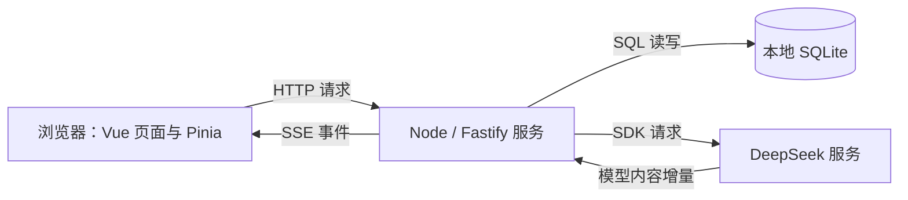
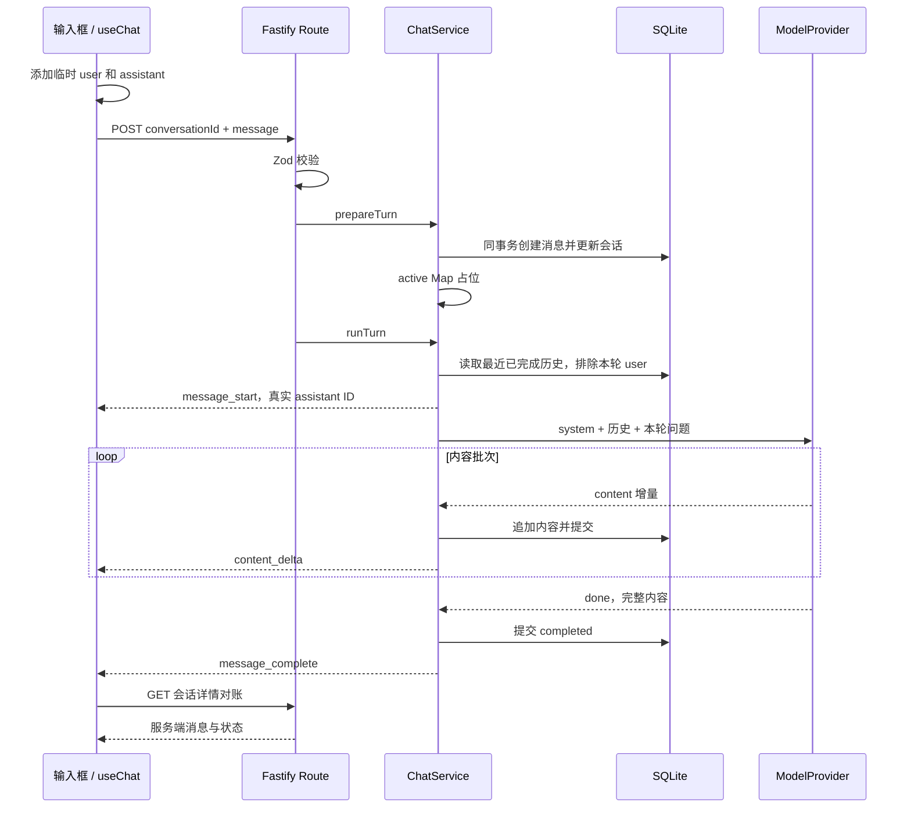
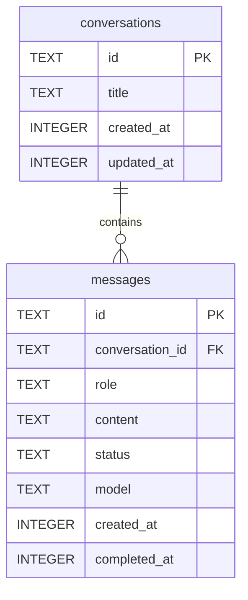
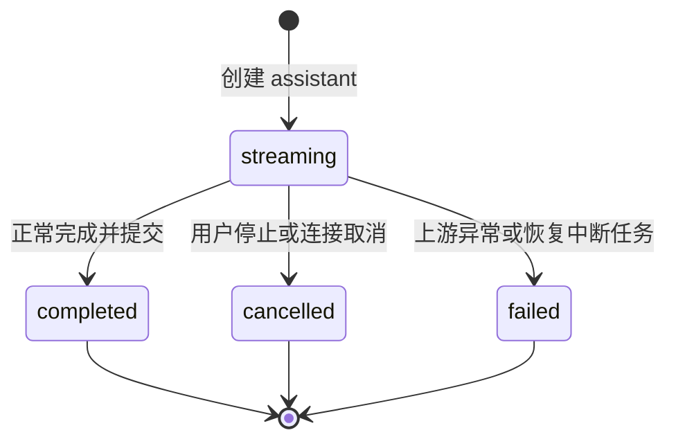

# 一期技术与功能导引：从聊天功能到可靠系统

本文面向希望真正理解 HealthAI 实现的学习者。目标是让你不仅知道“用了什么框架”，还能沿源码解释一次请求、预测故障结果，并判断未来需求应该改哪一层。

本文只讲一期 Feature 01：本机、单进程、单用户的桌面 Web 聊天应用。实现契约参考[一期开发文档](reference/PHASE1_DEVELOPMENT.md)，设计原因参考[一期决策](reference/DECISIONS.md)。二期实验或依赖不代表一期聊天使用了对应能力。文中的“未来演进”是讨论，不是已实现功能或开发授权。

阅读不能代替实践。建议每读一章，先合上文档复述，再打开对应源码验证。所有练习都可以通过阅读、画图和合成数据推演完成，不要求修改代码、调用真实模型或读取日常聊天数据库。

## 阅读地图

| 学习目标 | 阅读章节 | 掌握标准 |
| --- | --- | --- |
| 看懂整个应用 | 1—4 | 能画出浏览器、服务器、数据库、模型之间的关系 |
| 追踪一次聊天 | 5—9 | 能解释请求、上下文、模型流和 SSE 的顺序 |
| 理解可靠性 | 10—13 | 能推演停止、断线、崩溃、迟到响应的结果 |
| 理解页面与性能 | 14—15 | 能区分渲染安全、滚动体验和数据规模问题 |
| 学会验证与排障 | 16—18 | 能为一个故障选择合适的证据和测试层级 |
| 检查是否吸收 | 19—20 | 能独立答题，并指出对应代码位置 |

## 1. 一期究竟交付了什么

用户可以新建、切换、删除会话，发送文本问题，逐步看到模型回答，停止生成，刷新后恢复历史，并阅读带表格、代码块和高亮的 Markdown 回答。

一期没有账号、健康档案、报告上传、RAG、工具调用、Agent、消息编辑、重新生成、自动标题、历史分页或虚拟滚动。页面是桌面布局，不是移动端适配方案。

它的学习价值不只是“请求一个大模型”。真正需要理解的是：一个可能持续很久、随时失败或被取消的任务，如何在页面、网络和数据库之间保持可解释的状态。

### 1.1 四个参与方



浏览器负责交互和显示；后端负责校验、业务规则、任务生命周期和密钥；SQLite 保存可恢复的数据；模型服务负责生成回答。模型没有直接读项目数据库，浏览器也不直接调用模型。

### 1.2 三份内容、三种含义

| 位置 | 内容 | 是否刷新后保留 |
| --- | --- | --- |
| Pinia | 当前视图消息、临时消息、流式拼接结果 | 不依靠 Pinia 保留 |
| SQLite | 会话和各状态消息的持久化记录 | 正常持久化后保留 |
| 模型请求 | system、选中的历史、本轮问题 | 每次请求重新组装 |

“数据库保存了历史”“页面展示了历史”“模型看到了历史”是三件事。数据库可以保存很多条，页面一期全量加载一个会话，但模型只收到有限历史。

**自测：** 刷新页面后历史仍在，是 Pinia 自动存盘吗？不是；页面重新请求后端，后端查询 SQLite。

## 2. 技术栈：每个工具解决什么问题

| 技术 | 在项目中的职责 | 不要误解成什么 |
| --- | --- | --- |
| Node 22 | 执行后端 JavaScript、提供 HTTP/文件/进程能力 | 不是前端框架 |
| TypeScript | 编译期检查类型和接口使用 | 不能自动校验外部 JSON |
| Vue 3 | 根据响应式状态更新组件 | 不负责数据库持久化 |
| Pinia | 管理会话列表、当前消息等共享页面状态 | 不等于服务器数据库 |
| Vue Router | 管理前端页面路由 | 不等于 Fastify API 路由 |
| Element Plus | 输入框、按钮、弹窗等界面组件 | 不负责聊天业务规则 |
| Vite | 前端开发服务、模块转换和生产构建 | 不代表生产 API 服务器 |
| Fastify | 注册 HTTP 接口、处理请求响应、生命周期钩子 | 不替代业务 Service |
| Zod | 在运行时验证实际收到的数据 | 不替代 TS 编译检查 |
| better-sqlite3 | 在 Node 中同步执行 SQLite SQL | 不提供分布式数据库能力 |
| OpenAI SDK | 调用兼容接口并消费上游流 | 使用它不代表模型由 OpenAI 提供 |
| markdown-it / highlight.js | 解析 Markdown、代码高亮 | 模型文本不能因此被当作可信 HTML |
| pnpm workspace | 组织 web、server、shared 及其依赖 | 不是三个独立生产服务 |

运行要求为 Node `>=22.12 <23`、pnpm `10.26.0`；精确依赖解析以 `pnpm-lock.yaml` 为准。

### 2.1 TypeScript 与 Zod 为什么同时存在

例如类型声明 `message: string` 能提醒项目开发者正确传参，但陌生客户端依然可以发送 `{"message":123}`。HTTP 数据进入程序时，TS 类型已经被擦除，因此路由必须用 Zod 校验。

还要注意：前端 REST 返回值中有类型断言，不能据此声称所有响应都经过了完整运行时校验；SSE 则有专门的事件结构和顺序检查。阅读源码时要区分“我告诉编译器它是什么”和“程序实际验证它是什么”。

## 3. 目录与分层：遇到问题应该找谁

源码链接相对本文所在目录，可直接点击。

| 层 | 主要源码 | 核心问题 |
| --- | --- | --- |
| 页面组装 | [ChatView.vue](../apps/web/src/views/ChatView.vue) | 页面启动和组件连接 |
| 输入 | [ChatInput.vue](../apps/web/src/components/chat/ChatInput.vue) | 发送、停止、输入法 |
| 前端控制器 | [useChat.ts](../apps/web/src/composables/useChat.ts) | 乐观消息、任务、切换、收尾 |
| 公共状态 | [stores/chat.ts](../apps/web/src/stores/chat.ts) | 页面显示什么 |
| HTTP 与事件校验 | [api/chat.ts](../apps/web/src/api/chat.ts) | 请求、读取响应流、协议检查 |
| SSE 文本解析 | [useSseParser.ts](../apps/web/src/composables/useSseParser.ts) | 跨分片解析事件 |
| 后端入口 | [index.ts](../apps/server/src/index.ts) | 配置、真实 Provider、监听和退出 |
| 应用组装 | [app.ts](../apps/server/src/app.ts) | 注入依赖、恢复、错误与关闭钩子 |
| 路由 | [chat.route.ts](../apps/server/src/modules/chat/chat.route.ts) | HTTP 校验与响应形式 |
| 业务 | [chat.service.ts](../apps/server/src/modules/chat/chat.service.ts) | 上下文、任务锁、流、状态 |
| 数据访问 | [chat.repository.ts](../apps/server/src/modules/chat/chat.repository.ts) | SQL、事务、排序和终态保护 |
| 模型适配 | [deepseek.provider.ts](../apps/server/src/providers/deepseek.provider.ts) | SDK 参数、上游流、错误映射 |
| 共享契约 | [shared/chat.ts](../packages/shared/src/chat.ts) | 消息类型和 SSE 事件类型 |

后端依赖方向是 `Route → Service → Repository / Provider`。Route 不直接拼 SQL，Repository 不负责发送 SSE，Provider 不直接操作页面。

这样分层不是为了文件多，而是为了变化可控：替换模型主要影响 Provider；改变数据库查询主要影响 Repository；改变停止规则主要影响生命周期层；改变气泡样式主要影响组件。

`buildApp(options)` 可以接收 Provider、数据库、时间函数等依赖，而不是强制使用真实模型和日常数据库。它体现了依赖注入：调用者提供可替换的能力，让同一份业务逻辑在测试环境中可控运行。

## 4. 启动与刷新：第一条消息之前发生什么

### 4.1 后端启动

入口 `index.ts` 大致按以下顺序工作：

1. 加载并校验配置。
2. 有有效非占位 Key 时创建 `DeepSeekProvider`。
3. `buildApp` 打开数据库、创建 Repository、恢复遗留消息，组装 Service 和路由。
4. 监听默认 `127.0.0.1:3000`。
5. 注册 SIGINT / SIGTERM 关闭处理。

启动不自动调用模型。占位 Key 可以用于启动骨架，但生成请求会遇到 `CONFIG_ERROR`。

配置入口是 [env.ts](../apps/server/src/config/env.ts)。根目录通过 `import.meta.url` 定位，不依赖启动命令的当前目录；相对数据库路径也按项目根解析。因此从不同 workspace 启动，不应意外产生另一份数据库。

### 4.2 前端初始化

`ChatView` 挂载后调用 `loadConversations()`。列表按最近更新时间排序：有会话就打开第一项，没有就创建新会话；如果加载列表失败，则先显示错误。

这意味着刷新后默认打开“最近更新的会话”，不是通过浏览器持久化恢复“刷新前选中的会话”。它们在日常使用中可能相同，但不是同一项保证。

### 4.3 开发代理与密钥边界

浏览器访问 `http://127.0.0.1:5188`，请求相对路径 `/api/...`；Vite 在开发环境把它转发到 Fastify 端口。浏览器视角下使用同源路径，不需要另建跨域调用方案。

Key 由后端读取，前端只收到业务响应。不要把密钥放进 `VITE_*`。根目录 `pnpm build` 包含类型检查和前端构建；它不会产出一个完整可部署的后端 JS 包，也不会自动配置静态文件托管。后端当前通过 tsx 执行源码。

## 5. 一次发送：把全部链路连起来

假设用户问：“请解释什么是流式输出。”



这张图省略了错误分支，后文会补全。源码中的准确顺序是先读历史，再发送 `message_start`，然后消费 Provider；不要把高层流程图理解为每一行源码的机械展开。

### 5.1 为什么先显示临时消息

网络和模型存在延迟。`sendMessage()` 先把用户问题和空 assistant 推入 Store，用户立即看到反馈，这叫乐观更新。

临时 ID 以 `local-` 开头，不是数据库主键。收到 `message_start` 后，只把本轮 assistant 临时 ID 绑定为服务端真实 ID；user 的真实 ID 等收尾 GET 一起校正。

前端 `generating=true` 不只表示“还在收字”，也覆盖收尾对账阶段。若一收到停止或最后一个字就解除限制，下一次请求可能撞上尚未释放的服务端任务锁。

### 5.2 什么叫对账

SSE 负责低延迟通知，GET 负责重新读取服务器已经保存的事实。生成正常结束、失败或取消后，控制器在适用条件下 GET 会话详情，用服务端 ID、内容、时间和状态替换临时数据。

它不是把本地消息再次提交，而是纠正本地视图。即使浏览器漏收最后一个终止事件，也可能通过 GET 找到已经完成的回答。

## 6. HTTP 契约与参数校验

| 方法与路径 | 输入 | 成功响应 |
| --- | --- | --- |
| POST `/api/conversations` | 无 body 或 `{}` | 201，`{ conversation }` |
| GET `/api/conversations` | 无 query | 200，`{ conversations }` |
| GET `/api/conversations/:id` | 非空 ID | 200，`{ conversation, messages }` |
| DELETE `/api/conversations/:id` | 非空 ID，无 body 或 `{}` | 200，`{ ok: true }` |
| POST `/api/chat/stream` | `{ conversationId, message }` | 200，SSE |

stream 两个字段均为字符串，trim 后非空，message 的 `.length` 最大为 8000；这是 JavaScript 字符串长度规则，不是严格的用户可见字符数量，也不是 token 数量。Zod `.strict()` 拒绝多余字段。ID 不强制 UUID 正则。Fastify 请求体上限为 128KiB。

前端校验让用户及时得到反馈；服务端校验保证绕过 UI 的请求也受约束。两者都有必要。

### 6.1 错误发生在响应之前还是之后

前置校验失败、会话不存在、会话忙或 Provider 未配置时，还没进入 SSE，可以返回 HTTP 400/404/409/500 等状态和 JSON `{ code, message }`。

响应头已经按 SSE 的 HTTP 200 发出后，模型再失败，就不能把原响应改为 HTTP 502；应发送 `message_error`。因此“Network 里看到 200”只说明流式响应已建立，不代表回答成功。

| 错误码 | 前置 HTTP 状态 | 含义 |
| --- | --- | --- |
| INVALID_PARAM | 400 | 输入不合法 |
| CONVERSATION_NOT_FOUND | 404 | 会话不存在 |
| CONVERSATION_BUSY | 409 | 同会话生成未收尾，或不允许删除 |
| CONFIG_ERROR | 500 | 模型配置或认证问题 |
| RATE_LIMITED | 429 | 上游限流 |
| UPSTREAM_TIMEOUT | 504 | 上游或内容等待超时 |
| UPSTREAM_ERROR | 502 | 上游非正常结果或协议失败 |
| INTERNAL_ERROR | 500 | 内部处理或存储失败 |

公开文案来自共享错误表，不把原始上游 body、headers、堆栈或 SQL 暴露到页面。

## 7. 上下文：模型如何“记住”上一轮

模型接口不会因为 `conversationId` 就自动读取项目历史。这个 ID 用于本地定位会话；Service 每次自己构造完整的模型输入：

```text
system prompt
+ 最近 20 条 completed 历史消息（排除本轮 user）
+ 本轮 user 消息
```

### 7.1 三种角色

`system` 设置助手行为边界；`user` 表达用户输入；`assistant` 表达历史回答。system prompt 位于 [system.ts](../apps/server/src/prompts/system.ts)，要求一般健康知识、说明不确定性、不作诊断或处方，并在紧急情形建议就医。

提示词是模型行为引导，不是程序权限控制，也不能保证模型永不出错。程序应保留校验、错误处理和清晰的产品边界。

### 7.2 为什么必须排除本轮 user

`prepareTurn()` 已经把本轮 user 写成 `completed`。若直接查询最近 completed，再在末尾追加当前问题，模型会看到两遍当前问题。

因此 Repository 在查询内部先排除本轮 ID，再取最近 20 条，然后恢复正序。若先取 20 条再在应用层排除，历史窗口可能无意中少一条。

例如历史是 `U1 A1 U2 A2`，当前是 `U3`，正确输入为：

```text
system, U1, A1, U2, A2, U3
```

### 7.3 20 条不等于 20 轮

常见完整一轮是 user 和 assistant 两条，所以 20 条通常接近 10 轮，但不能保证整轮边界：失败的 assistant 不进入历史，对应 completed user 仍可能留下；截取窗口也可能从 assistant 开始。

这是一种简单的消息窗口策略，不是对话摘要、长期记忆、RAG，也没有按 token 精确裁剪。`max_tokens:4096` 限制输出，不能替代输入上下文预算。

如果最早信息超出窗口，模型可能不再知道它；数据库保存着这条信息也不会自动改变这一点。

## 8. Provider：隔离 SDK 与业务

[model-provider.ts](../apps/server/src/providers/model-provider.ts) 定义 `ModelProvider`：输入模型名、消息和可选 AbortSignal，返回 `AsyncIterable<ModelEvent>`。

可以把 `AsyncIterable` 理解成“未来陆续出现的事件序列”：`iterator.next()` 返回 Promise，表示等待下一个事件。`async *` 生成器通过 `yield` 交出事件，而不是一次返回完整字符串。

### 8.1 两套事件不能混淆

| 内部模型事件 | 用途 |
| --- | --- |
| `content` | 正文片段，Service 收集并批次落库 |
| `reasoning` | 兼容上游格式的内部事件，一期 Service 不保存、不下发 |
| `done` | Provider 确认正常完成，带完整正文供 Service 核对 |

这些不是浏览器 SSE 事件。Service 要完成持久化和状态转换后，才将业务事件发给浏览器。

### 8.2 DeepSeek 请求参数

一期使用 OpenAI SDK 的兼容接口，关键参数是 `stream:true`、顶层 `thinking:{type:'disabled'}`、`max_tokens:4096`，默认模型为 `deepseek-flash`。SDK 显式 `maxRetries:0`，没有自动 fallback。

关闭自动重试使上游行为更可控，但不等于已经实现请求幂等。若要安全自动重试整个生成 POST，需要额外的幂等键、去重和结果复用设计；一期没有这些机制。

### 8.3 为什么不能把 EOF 当成功

流关闭可能来自正常结束、断网、截断或取消。Provider 只有在消费结束后确认调用方未取消、见到正常 `finish_reason:'stop'`、正文非空，才生成 `done`。

`length` 截断、内容过滤、空回答、没有 stop 或异常终止都属于失败。Service 还要检查 `done.fullContent` 与已收到正文一致，避免“收到的增量”和“宣称完成的全文”不一致。

SDK 的认证错误、限流和超时会映射到项目安全错误码。未知错误不会直接透传给用户。

## 9. SSE：流式输出到底怎样传输

SSE 是建立在 HTTP 响应体上的文本事件格式。这里浏览器发一次 POST，服务器持续在同一个响应中发送多帧事件。输入通过普通请求发送，输出通过响应流返回；一期不需要双向 WebSocket 长连接。

原生 `EventSource` 面向 GET，不适合直接承载本项目的 POST JSON，因此采用 `fetch + ReadableStream` 手动读取和解析。

### 9.1 一帧长什么样

```text
event: content_delta
data: {"delta":"你好"}

```

事件以空行结束；上例最后有一个空行。多条 `data:` 行会按协议用换行连接。`JSON.stringify` 会转义正文里的换行，避免正文破坏帧结构。

| 事件 | 数据 | 业务含义 |
| --- | --- | --- |
| message_start | `{ messageId }` | 数据库 assistant 已建立，绑定真实 ID |
| content_delta | `{ delta }` | 新增正文已提交，可以追加显示 |
| message_complete | `{ messageId }` | 数据库已提交 completed |
| message_error | `{ code, message }` | 本次生成失败 |
| message_cancelled | `{ messageId }` | 本次生成取消，断开的浏览器未必收得到 |

正常序列是 start → 零个或多个 delta → 一个终止事件。错误也可能在 start 发出前发生，因此客户端允许 `message_error` 不依赖 start。未知事件名会被忽略；已识别事件的非法结构或顺序会被拒绝。

### 9.2 网络 chunk 不等于事件，也不等于 token

一次 `reader.read()` 可能读到半个 UTF-8 字符、一帧的一部分或多帧。模型 token、SDK chunk、Service 批次、SSE 帧、浏览器 read chunk 都不是同一个边界。

正确的解析分为四层：

```text
字节流 → TextDecoder 连续解码 → SSE 跨分片组帧 → JSON 与事件顺序校验
```

`TextDecoder` 的 `{stream:true}` 保留未完成字符字节，避免中文或 emoji 被截断；SSE parser 跨 chunk 保存行和事件，兼容 LF、CRLF 以及 CR/LF 分开到达。没有空行结束的不完整帧不派发，帧大小也有限制。

客户端检查 start 是否重复、delta 是否出现在 start 之后、终止消息 ID 是否一致。收到终止事件后取消 reader、释放锁，不必等连接 EOF；若先 EOF 却没有终止事件，按失败处理。

### 9.3 心跳和缓冲

后端每 15 秒尝试写注释 `: ping`，帮助连接保活。它不是模型正文，不进入数据库，也不能证明模型正在产出内容。响应设置 `no-cache` 和 `x-accel-buffering:no` 等头，但实际代理行为仍需部署时验证。

## 10. 数据库：数据结构、事务和状态机

源码：[schema.sql](../apps/server/src/database/schema.sql)、[db.ts](../apps/server/src/database/db.ts)、[Repository](../apps/server/src/modules/chat/chat.repository.ts)。

### 10.1 两张表如何关联



ID 由应用生成 UUID，时间为毫秒。SQL 使用 snake_case，返回对象用 camelCase。`model` 对 user 为 null，对 assistant 记录模型名；`completed_at` 表示终止时间，不只属于成功消息。

`ON DELETE CASCADE` 使删除会话同时删除消息，前提是连接开启外键。它负责数据库关联一致性；“生成中不能删”属于 Service 业务规则，外键不能替代它。

### 10.2 为什么 createTurn 必须用事务

一次发送需要插入 user、插入空 assistant、更新会话时间。三步应一起成功或一起失败，否则可能留下只有 user 的半轮数据，或错误的更新时间。

这里的事务只跨短 SQL 操作，不跨模型网络等待。模型可能耗时几十秒，长期持有写事务会阻塞其他写入，也无法让远程模型请求成为 SQLite 事务的一部分。

参数化 SQL 通过 `?` 绑定值，避免把用户输入当 SQL 语法拼接。

### 10.3 消息状态机



user 创建时就是 completed。`pending` 虽存在于类型和 schema 中，但不是一期正常 assistant 创建路径的必经阶段。

`finalizeMessage` 的 UPDATE 只匹配 pending/streaming，`appendMessageContent` 只匹配 streaming assistant。这样已经 completed 的消息不会被迟到 close 改成 cancelled，终态也不会被重新追加内容。

这叫把状态约束放到真正写数据的位置：只在上层写一个 `if`，很容易在别的调用路径漏掉。

### 10.4 稳定排序与时间回拨

同一事务产生的 user 和 assistant 可能有相同时间。只按 `created_at` 排序不能保证稳定顺序，因此消息查询再按 SQLite 内部 rowid 排序。

历史查询先按时间、rowid 倒序取得最近 N 条，再按正序返回，保证输入模型的顺序正确。rowid 是内部辅助顺序，不是对外消息 ID，也不应直接当成未来分页协议承诺。

会话更新时间通过 `MAX(updated_at, 新时间)` 更新，减少系统时间回拨导致排序倒退的问题。

### 10.5 WAL、FULL、busy_timeout 分别保证什么

| 设置 | 目的 | 边界 |
| --- | --- | --- |
| WAL | 使用预写日志，有利于读写并发和恢复 | SQLite 写入仍有互斥，不是多写者分布式数据库 |
| foreign_keys=ON | 执行外键和级联规则 | 不负责应用权限 |
| synchronous=FULL | 加强提交的持久性 | 不是磁盘损坏时绝对不丢数据的承诺 |
| busy_timeout=5000 | 遇锁时允许等待一段时间 | 同步驱动等待会阻塞当前 Node 线程 |

数据库索引 `(conversation_id, created_at)` 帮助定位会话及时间顺序，但不会把全量读取自动变成分页，也不意味着读取海量正文没有成本。

当前没有版本化迁移框架。修改 `CREATE TABLE IF NOT EXISTS` 不会自动升级已有表；未来改字段必须考虑旧库迁移。备份活跃 WAL 数据库也不能只随意复制主 db 而忽略尚未合并的日志。

## 11. 可靠流式：为什么先落库再发送

### 11.1 先显示、后保存有什么问题

假设回答“建议规律作息”已经发到浏览器，服务器随后在写库前崩溃。用户明明看见过这句话，刷新却消失，前端体验与持久化事实发生冲突。

一期采用：

```text
收集增量 → SQLite 提交 → 发送 content_delta
最终状态提交 → 发送 message_complete
```

因此已收到的正文应是已提交正文的一部分；浏览器可能少看到数据库中的最后几段，但不应靠“浏览器见过、数据库没写过”的内容维持一致性。这不是数据库与网络之间的分布式原子提交，不能保证每帧一定送达。

### 11.2 为什么采用批次

逐 token 写库会产生大量同步 SQL、提交和网络帧。Service 默认按 **75ms 或未提交内容达到 1024 UTF-8 字节** 触发刷新，在延迟与开销之间取折中。

它们是触发条件，不是严格的延迟 SLA。事件循环繁忙、同步磁盘操作或网络背压都可能延迟实际发送。

Service 用 `content` 保存已收到全文，用 `persistedLength` 标记已提交到哪。新增部分为 `content.slice(persistedLength)`；字符串切片按 JS 字符串位置，而批次大小判断用 UTF-8 字节数，两者用途不同。

### 11.3 为什么计时刷新不能重复 next

即使上游暂时没有新内容，已有未提交片段也需要按时间刷出。`nextOrTick()` 让一次上游 next 与定时器、取消信号竞争。

定时器先到时，继续等待原来的 next；只有真正消费了该结果，才调用新的 next。否则同一 iterator 上可能堆积并发读取，破坏流顺序和资源控制。

### 11.4 背压是什么

如果浏览器消费很慢，`response.write()` 可能返回 false：数据已进入发送缓冲，但应等待 `drain` 再继续写，不是立即重发同一段。

`SseWriter` 串行发送业务帧，写入受阻时等待 drain，默认等待上限 10 秒；心跳在写入受阻时跳过，不排成长队。Service 等待 send，因此不会无条件把所有应用事件推入 socket 缓冲。

这控制了应用发送队列，但 Provider 和 Service 仍保留本轮全文，SDK 和网络也有自己的缓冲，所以不能称为全链路固定内存实现。

## 12. 停止、失败与关闭：任务如何真正结束

### 12.1 停止是一条传导链

```text
点击停止
→ 前端 AbortController.abort()
→ fetch 响应读取被取消、连接关闭
→ SseWriter 发现响应断开
→ 本轮服务端 controller.abort()
→ Provider / SDK 收到 signal
→ 尝试提交 cancelled 和未提交尾部
→ 释放 active 占位，完成 settled
→ 前端 GET 对账
```

一期没有独立 stop 接口。前端先立即标记本地 cancelled，让用户得到反馈；这不意味着服务器同一瞬间已完成收尾，最终仍要以 GET 事实校正。取消也不能承诺远端服务在零延迟内停止计算或计费。

监听的是响应流 close，而不是把请求体读取结束当成断开。POST body 读完只是服务器接收完问题，回答仍可能持续很久。

### 12.2 超时为什么只让正文续期

Service 默认内容空闲超时为 60 秒，从开始上游流程附近计时，每次收到非空 content 重置。reasoning 和 SSE 心跳都不续期，否则模型一直不给正文也可能永久占用任务。

SDK 也有自己的超时配置，两者职责不同。60 秒不是整轮固定总时长：只要持续有正文，生成可以超过 60 秒。

### 12.3 failed 与 cancelled 如何区分

用户停止或断开引起的 abort 通常为 cancelled；内容超时虽也会触发 abort，但必须保留 failed / UPSTREAM_TIMEOUT 语义。

异常处理先判断当前是否外部取消、是否超时，再主动 abort 清理上游。若先主动 abort 再判断，就会把普通错误误分类成用户取消。

失败和取消时会尝试在同一终态事务里保存尚未提交的尾部。若数据库本身已经不能写，终态也可能无法保存；代码报告 INTERNAL_ERROR，不能据此承诺所有失败现场都能正常落库。

### 12.4 finally 为什么重要

无论成功、失败、取消，都要清理计时器、尝试关闭 iterator、释放会话锁、resolve settled。不合作的 iterator.return() 不能无限阻止任务释放。

这是异步资源管理的基本能力：错误处理不只是显示文案，还必须回答“锁释放了吗、连接停了吗、等待者能继续吗”。

### 12.5 正常关闭与突然崩溃

正常 SIGTERM / SIGINT 触发应用关闭，先取消并等待活动任务收尾，再关闭自有数据库连接。SIGKILL 或进程崩溃没有机会执行 finally，数据库可能留下 streaming。

下次 `buildApp` 启动时，`recoverInterruptedMessages()` 把遗留 streaming assistant 标记 failed，保留已提交正文，不自动再次调用模型。恢复数据状态不等于恢复远端生成任务。

若 completed 已提交但 complete 事件没送达，GET 应返回 completed；迟到断开不能把它改成 cancelled。

## 13. 前端竞态：旧请求不能写入新页面

### 13.1 公共状态与任务控制对象分开

Store 只有六类字段：`conversations`、`currentConversationId`、`messages`、`loading`、`generating`、`error`。它们表达 UI 状态。

`useChat` 闭包中的 active、AbortController、settled、viewVersion 表达异步任务控制。Store 不直接暴露它们，减少组件误操作任务生命周期的机会。

`useChat()` 还通过 WeakMap 为同一个 Store 复用控制器，避免组件分别调用时各自持有一份互不知情的 active。

### 13.2 为什么 abort 之外还要检查身份

设会话 A 生成中，用户切换 B。A 的某个回调可能已经排队，即使 abort 已发出，也不能假定所有旧回调立即消失。

`owns(task)` 同时检查 active 是否仍是这个任务、当前会话是否匹配；事件回调还检查是否已 abort。切换、新建先停止 A 并等待 settled，再加载新内容。GET 操作通过 viewVersion 检查结果是否仍属于当前视图。

取消减少无用工作，身份检查阻止过期结果覆盖页面，等待收尾维护顺序；三者解决不同问题。

### 13.3 明确拒绝与结果不确定

| 情况 | 前端行为 | 原因 |
| --- | --- | --- |
| 未 start 且收到明确 HTTP 拒绝 | 回滚本轮临时消息 | 服务端按前置失败拒绝请求 |
| 网络断开，不确定后端是否写入 | 保留可见内容，GET 对账 | 请求可能已经被执行 |
| 正常 complete | GET 校准 ID、状态、时间、正文 | 临时消息不应长期充当权威记录 |
| GET 也失败 | 保留本地文字并提示稍后刷新 | 不用猜测覆盖掉用户已见内容 |

自动重发 POST 可能生成第二组消息和第二次模型调用。取消请求或网络报错不等于“服务器从未收到”，这是理解分布式交互最重要的常识之一。

对账最多 20 次，仍 streaming 时相邻尝试约间隔 100ms。但每次 REST fetch 没有业务级超时，因此不是严格两秒内必定结束；网络永久挂起仍是当前限制。

### 13.4 删除规则

生成中的当前会话禁止删除；删除非当前会话不应取消当前流。删除当前会话后打开列表第一项；删除最后一个会话保留空态，再次发送时可以自动创建。

后端必须重复执行忙状态检查，不能只信 UI 禁用按钮。多标签页可绕过前端状态，最终仍由当前后端进程的 active Map 防止同会话并发。

## 14. 页面渲染：Markdown、安全与滚动

### 14.1 从响应式状态到 DOM

Service 发 delta，前端控制器把它追加到 assistant.content，Pinia 的响应式数据变化触发相关组件更新。`ChatMessage` 的 computed 重新生成该消息的 Markdown HTML。

这不是每个增量都主动重建整个页面；但正在生成的长回答会反复解析其累计全文，长度和内容复杂度增长仍会产生开销。Vue 的响应式优化不会自动解决所有计算或 DOM 规模问题。

### 14.2 为什么这里的 v-html 要特别小心

user 正文通过 Vue 插值显示，默认按文本转义。assistant 正文需要 Markdown，因此先经过私有 `renderMarkdown()`，再交给 `v-html`。

渲染器设置 `html:false`，恶意 `<script>` 等原始 HTML 不会作为原生标签直接执行；链接使用解析器的协议校验，并固定 `target='_blank'`、`rel='noopener noreferrer'`。高亮只注册有限语言，未知语言或高亮失败安全回退为转义代码。

`v-html` 本身不提供清洗保证，安全依赖整个渲染管道。若未来启用原始 HTML、添加插件或允许新协议，必须重新评估并做安全回归；不能只因为“模型生成”就信任内容。

Markdown 图片仍可能触发外部资源请求。HTML 转义保护不等于网络资源隐私控制或通用内容安全方案。

### 14.3 输入法为什么会影响 Enter

中文输入法选词也会按 Enter。ChatInput 同时检查 composition 状态、`event.isComposing` 和 keyCode 229，避免把选词当发送。普通 Enter 发送，Shift+Enter 换行。

输入框发出 send 后立即清空，目前没有发送失败后自动恢复草稿的功能。这是可讨论的体验改进，不应描述成现有行为。

### 14.4 自动滚动如何尊重阅读

底部距离计算为：

```text
gap = scrollHeight - clientHeight - scrollTop
```

接近底部 24px 内恢复跟随；离底部超过一屏才停止跟随，显示“回到底部”。这不是“只要向上滚一像素就停止”。点击回到底部或切换会话恢复跟随。

DOM 高度要等 Vue 更新后才准确，所以 MessageList 使用 nextTick 和 post watch；watch 的 cleanup 阻止旧的异步滚动在新视图中执行。

## 15. 长会话性能：分页、虚拟滚动与上下文分别管什么

一期 MessageList 用 `v-for` 渲染当前会话全部消息，详情接口也全量返回消息；没有虚拟滚动和历史分页。

| 机制 | 控制的规模 | 无法单独解决的问题 |
| --- | --- | --- |
| 历史分页 | 数据库读取、传输、客户端持有的数据量 | 加载越来越多后 DOM 仍可能过多 |
| 虚拟滚动 | 挂载的消息组件和 DOM 数量 | 不会自动减少接口下载的数据 |
| 模型上下文窗口 | 每次发给模型的历史数量 | 不减少页面历史和数据库总记录 |
| 流式批次 | 更新、提交和事件的频率 | 不解决历史无限增长 |

因此“模型只看 20 条，所以页面不会卡”是错误推论。“加虚拟滚动就解决大数据量”也不完整。

### 15.1 聊天虚拟滚动为什么更难

普通固定行高列表可以用下标直接算偏移。聊天消息则高度不固定，流式回答还在持续增高，代码块、表格、窗口宽度、字体和图片加载都可能改变布局。

未来若实现，应考虑动态测量高度、缓存与失效、列表上方占位空间，以及用户正在阅读历史时不要被新回答拉走。向上插入历史时，可记录首个可见消息 ID 及其相对视口偏移，更新后恢复这个锚点；仅按旧 scrollTop 往往会跳动。

分页也要定义稳定游标、边界去重和并发更新规则。直接使用 OFFSET 在列表变化时可能跳项或重复；仅用毫秒时间作游标又可能漏掉同毫秒消息。具体协议需另行设计。

### 15.2 应先优化哪一项

建议先用合成数据测量，再决定：首屏慢优先看查询、传输和解析；历史滚动卡优先看 DOM 数量和布局；长回答生成卡优先看 Markdown 重算、高亮和更新频率。

未来可先做最近一批加载和向上分页，再按实际性能引入虚拟滚动。这个顺序是演进建议，不是已实施方案，也没有一个适用所有内容的“超过多少条必卡”阈值。

## 16. 测试：如何证明行为，而不是只证明能运行

一期基线文档记录的是 105 项自动化测试及已接受的真实模型、人工 UI、P6 验收。这是历史基线数字；当前仓库包含二期实验测试，不能把旧数字当作今天重新执行的结果。

| 测试位置 | 重点问题 |
| --- | --- |
| [repository.test.ts](../apps/server/test/repository.test.ts) | 消息事务、终态、恢复、关联数据 |
| [context.test.ts](../apps/server/test/context.test.ts) | 历史窗口、顺序、本轮排除 |
| [provider.test.ts](../apps/server/test/provider.test.ts) | SDK 参数、流格式、结束与错误映射 |
| [chat-stream.test.ts](../apps/server/test/chat-stream.test.ts) | 业务流和持久化顺序 |
| [faults.test.ts](../apps/server/test/faults.test.ts) | 超时、异常、故障处理 |
| [lifecycle.test.ts](../apps/server/test/lifecycle.test.ts) | 取消、关闭、资源释放 |
| [web/chat.test.ts](../apps/web/test/chat.test.ts) | 前端控制、SSE 协议与状态 |
| [web/conversations.test.ts](../apps/web/test/conversations.test.ts) | 会话切换、新建、删除及竞态 |
| [web/rendering.test.ts](../apps/web/test/rendering.test.ts) | Markdown、渲染和滚动策略 |

### 16.1 各种证据能证明什么

Fastify inject 可以在不监听真实端口的情况下验证路由、状态码和响应，但不能独自证明真实 TCP 断开传播正确。mock Provider 能稳定制造错误，不能证明真实 API 已连通。字符串转义测试有价值，但浏览器安全还需要实际 DOM 检查。

P6 使用受控 Provider、临时数据库、随机本机端口和独立浏览器配置，覆盖真实连接断开、慢读背压、SIGKILL 恢复、SIGTERM 收尾、Markdown DOM 和合成 Key 泄漏检查。它不调用真实模型；真实模型行为由历史 P2/P4/P5 独立验证。

一个测试通过只对其触发场景和断言有效，不应从一次耗时推导生产 SLA。

### 16.2 推荐怎样阅读测试

先读测试名和断言，再看 fixture 如何触发条件，最后回到实现找保护点。例如“终态不倒退”的有意义验证应尝试在 completed 后追加或取消，并确认数据库没变，而不只是断言函数被调用过。

学习时优先掌握这些可迁移的测试能力：控制异步时序、替换外部依赖、使用独立数据库、检查失败后的最终状态，以及确认资源释放。

## 17. 运行命令与学习观察

已有依赖和 `.env` 时，不需要为阅读文档重新安装或覆盖配置。两个终端分别运行：

```sh
pnpm dev:server
```

```sh
pnpm dev:web
```

打开 `http://127.0.0.1:5188`。不发送问题只观察页面和接口不会主动调用模型；发送问题会调用真实模型，可能产生费用。练习使用合成内容。

| 命令 | 用途 | 真实模型调用 |
| --- | --- | --- |
| `pnpm test` | 离线自动化回归，包含 server 与 web 测试 | 无 |
| `pnpm typecheck` | TS / Vue 类型检查 | 无 |
| `pnpm build` | 类型检查和前端生产构建 | 无 |
| `pnpm test:provider` | 独立真实 Provider 验证 | 有，通常一次 |
| `pnpm verify:p4` | 历史 P4 综合验证 | 有，两次 |
| `pnpm verify:p5` | 历史多轮上下文验证 | 有，五次 |
| `pnpm verify:p6` | 离线回归及受控网络/进程/浏览器检查 | 无 |

`verify:p1` 是早期空骨架断言，不能用来验收当前聊天应用。学习文档不要求重复历史真实调用，也不要求为了读源码执行整套浏览器演练。

### 17.1 只读观察清单

1. 在 Network 中找到会话列表和详情，区分它们返回的数据。
2. 若自行决定发送合成问题，检查 POST 只携带 conversationId 和 message。
3. 查看 SSE Content-Type 和事件顺序，观察 content_delta 是追加内容而非全文快照。
4. 观察结束后的 GET 详情，它就是对账而非第二次生成。
5. 点击停止后观察本地即时反馈与后续 GET，区分体验变化和服务端终态。
6. 刷新并检查历史是否恢复，解释数据来源。

浏览器面板、日志和数据库查看工具都可能包含聊天正文。练习不读取日常健康数据、不复制密钥、不把原始响应随意贴到外部。

## 18. 故障推演与定位顺序

| 现象 | 优先检查 | 应理解的原因 |
| --- | --- | --- |
| POST 400，没进入 SSE | 请求结构、trim、长度、未知字段 | 运行时校验在响应建立前 |
| POST 409 | active 是否仍在生成或收尾 | 停止动作不等于锁已释放 |
| HTTP 200 但显示生成中断 | 是否收到 message_error、是否缺终态 EOF | HTTP 成功与业务成功不同 |
| 开发页面看不到增量 | 上游是否产出、批次提交、代理缓冲、前端解析 | 流式由多层共同决定 |
| 刷新后比刚才多一段内容 | DB 已提交但网络未送达 | 先提交后发布允许前端暂时落后 |
| 进程重启后部分回答为 failed | 上次是否留下 streaming | 启动恢复不自动重新生成 |
| 切换后混入旧回答 | owns、abort、settled、viewVersion | 迟到异步结果需要身份隔离 |
| 模型忘记最早信息 | 历史窗口、状态过滤、输入 token 规模 | 存储历史不等于全部发送模型 |
| 长会话卡顿 | 全量详情、DOM、高亮、Markdown 计算 | 20 条模型窗口不保护页面性能 |

定位时沿边界收集证据：用户操作 → 前端状态 → HTTP/SSE → Service → Repository/Provider。先找“最后一个确定正确的边界”，再看下一层；不要看到模型问题就盲目修改提示词。

下面三个时间点特别适合锻炼推理：

- **DB 追加后、delta 发送前断网：** GET 可能看到浏览器没收到的内容；保留数据库事实。
- **completed 提交后、complete 发送前断网：** 最终应保持 completed；不能因为 close 倒退。
- **模型返回部分内容但还没落库时 SIGKILL：** 内存内容可能丢失；恢复只保留已提交部分。

## 19. 学习练习：只讨论与阅读，不要求改代码

### 19.1 第一遍：复述架构

用自己的话回答：Vue 为什么不能直接读 SQLite？后端为什么不把 Key 返回浏览器？Route、Service、Repository、Provider 各自负责什么？

参考要点：浏览器与本地 Node 进程能力不同；Key 属于服务器信任边界；分层隔离协议、业务、存储和供应商变化。即使技术上另有架构选择，本项目也采用了这条边界。

### 19.2 第二遍：追踪一轮消息

在纸上列出以下时刻的本地 ID、数据库 ID、正文、状态：发送前；临时消息加入；createTurn 后；start 后；第一批 delta 后；complete 后；GET 后。

参考要点：开始时数据库无本轮；createTurn 后数据库已有两条；start 只替换 assistant ID；delta 追加正文；GET 最终统一真实记录。不要把前端临时 user ID 当数据库 ID。

### 19.3 第三遍：反例推理

| 问题 | 参考判断 |
| --- | --- |
| 把 DB 写入改到 delta 发送之后会怎样？ | 已显示内容可能在崩溃后无法恢复 |
| 只按 finish_reason stop 立即发 complete 呢？ | 尚未确认剩余流正常结束，也未完成业务持久化 |
| 把 user 写库后不排除就取历史呢？ | 当前问题可能重复进入模型输入 |
| 停止只改按钮文字不 abort 呢？ | 上游仍运行，任务和资源可能继续占用 |
| abort 之后完全取消身份检查呢？ | 已排队回调仍可能污染新视图 |
| 所有网络错误自动重试 POST 呢？ | 可能重复写入、重复调用和计费 |
| 只加虚拟滚动、不改全量 GET 呢？ | 初始传输、解析和数据内存仍可能很大 |
| 把事务包住整个模型请求呢？ | 长时间占用数据库写事务，无法原子控制远端 |

### 19.4 第四遍：设计但不实施一个需求

假设未来要做“向上加载更早消息”，先写下接口游标、稳定排序、去重规则、滚动锚点、生成中如何加载、刷新如何恢复，以及哪些现有测试需要保留。

参考思路：先定义可观察行为和不变量，再选技术方案。不能只写“安装虚拟列表库”，因为库无法替你决定数据契约和异步一致性。

## 20. 掌握检查与后续学习路径

下面的问题建议先独立答，再对照前文：

1. 模型为什么没有自动记住 SQLite 中的全部消息？
2. 20 条历史为什么不保证 10 个完整问答轮次？
3. HTTP 200 为什么可能对应 failed？
4. 一个 read chunk 为什么不能直接 JSON.parse？
5. message_start 为什么要带数据库 ID？
6. 为什么收到 complete 之后还要 GET？
7. 为什么数据库终态不能被迟到 close 覆盖？
8. 为什么超时会用 abort，但不能统一记成 cancelled？
9. 为什么 finally 不能一直等待一个不合作的上游 iterator？
10. 为什么 Pinia 不保存 AbortController 也能控制任务？
11. 为什么 single-process 的 Map 不能保证多进程同会话互斥？
12. 为什么分页、虚拟滚动和上下文窗口需要分开设计？
13. 为什么 html=false 不等于全部内容安全问题都已解决？
14. 为什么真实 TCP、真实模型与 mock 测试不能互相冒充？
15. 如果只看按钮能发消息，遗漏了哪些可靠性要求？

对应章节分别为：7、7、6、9、5、5/13、10/12、12、12、13、12/边界、15、14、16、10—13。

真正吸收的标准不是背出答案，而是能给出一个具体反例、指出保护它的代码位置，并说明这个保护还没有覆盖什么。

### 一期必须牢记的六条不变量

- 正文先提交数据库，再发布 delta。
- 最终状态先提交，再发布完成事件；终态不可倒退。
- 同一会话只能有一个尚未收尾的生成任务。
- 取消要传导到模型调用，并最终释放资源和占位。
- 不确定的 POST 结果通过 GET 查询，不自动重发生成。
- 旧任务、旧视图的异步结果不能污染新会话。

这些能力可以迁移到上传、导出、支付查询、后台任务和其他长连接系统，但具体业务仍需重新设计幂等、权限和恢复策略。

### 一期边界与下一步

一期是本机单进程原型：SQLite 明文保存，无账号隔离、加密和多进程协调；没有分页、输入 token 预算、完整生产部署和备份方案；REST 对账也没有严格总截止时间。不能直接把当前无鉴权接口暴露到公网。

掌握一期后，二期可在这些基础上学习结构化输出、Function Calling、RAG 和人工确认，但这些能力不能替代一期的状态、协议与资源管理。当前二期路线见[二期学习计划](PHASE2_LEARNING_PLAN.md)；历史验收见[一期验收](archive/phase1-validation/ACCEPTANCE.md)。本文扩写只涉及学习材料，不启动任何后续业务开发。
