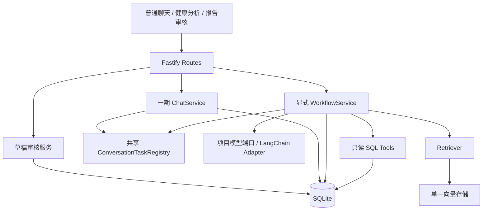

# HealthAI 二期技术实现说明文档

> 历史技术设计：当前技术路线以 [`PHASE2_LEARNING_PLAN.md`](../../PHASE2_LEARNING_PLAN.md) 为准。不要据此继续扩展通用 workflow、OCR 或复杂持久化实体。

- 文档编号：HAI-F02-TECH
- 版本：1.2（测试前置与估算配套修订）
- 修订日期：2026-11-16
- 状态：待用户审查；本文定义未来实现，不表示能力已验证
- 配套文档：`docs/archive/phase2-product-route/PHASE2_REQUIREMENTS.md`、`docs/archive/phase2-product-route/PHASE2_DEVELOPMENT_PLAN.md`

## 1. 架构与约束

沿用 Node 22、pnpm 10、Vue 3/Pinia、Fastify 5、Zod 4、OpenAI SDK、better-sqlite3。保留一期 chat 模块和持久化先于事件的生命周期，新增 health、ai、knowledge 模块；不重写为通用 Agent，不引入分布式任务或默认采用 LangGraph。



只有文字聊天、报告识别、Embedding 三种能力端口，不假设同一供应商全部具备。Provider、Prompt、工具、检索、编排和存储职责隔离。

一期保留：严格 `{conversationId,message}` 请求、五类消息事件、同会话占位、先落库后 delta、唯一终态、EOF 无终态失败、response close 取消、背压控制、旧请求不污染新会话、不自动重发结果不确定的 POST。

## 2. 模块与依赖

建议目录：

```text
apps/server/src/
  common/                    SSE transport、任务注册表、安全错误
  database/migrations/       有序版本迁移
  modules/chat/              保留一期业务生命周期
  modules/health/            草稿、审核、Measurement、上传
  modules/knowledge/         文档管理、索引任务
  modules/ai/
    ports/ adapters/langchain/
    prompts/ structured-output/ tools/ rag/ workflows/ evaluation/
apps/web/src/
  api/workflow.ts api/health.ts api/knowledge.ts
  composables/useWorkflow.ts
  views/health/ components/workflow/
packages/shared/src/         DTO、错误常量、事件联合类型
```

按需创建文件，不提前铺满空抽象。`shared` 保持零运行依赖，只导出类型和常量；服务端用 Zod 校验输入/模型输出，前端独立运行时事件解码器。通过契约样本及类型检查防止两端漂移。若后续共享运行时 Schema，需另行变更包依赖约定。

## 3. 新旧任务共享占位与关闭

提取小型 `ConversationTaskRegistry`，作为 buildApp 单例注入 ChatService、WorkflowService 和删除检查。

- 同步 reserve(conversationId, taskId)：首次 await 前检查关闭状态和占位。
- 占位成功后短事务创建 user/assistant、workflow run；事务失败立即释放同一 taskId 的占位。
- release 必须校验 taskId，防旧任务 finally 释放新任务占位。
- 删除通过同一注册表检查；同会话 chat/workflow 互斥，返回既有 CONVERSATION_BUSY。
- 普通聊天无需为复用强行转换为工作流；两者仅共享占位、传输能力和可复用持久化操作。
- 服务关闭先拒绝所有新任务，取消聊天、报告解析和索引任务，等待有界收尾，再关 DB；索引/解析使用独立任务集合，也纳入关闭协调器。
- 不无限等待不合作 iterator。使用截止时间与回调失效标记；超期任务不得再写数据库或发布事件，启动恢复负责处理尚未落终态记录。

SQLite 事务不包含上游网络等待。首版不支持多进程共享占位；扩大运行边界须另做跨进程互斥设计。

## 4. AI 模型端口与 LangChain 接入

一期 Provider 仍只完成文本 stop＋非空正文，不放宽现有判据。二期新增端口，内部消息明确支持 system/user/assistant/tool，assistant tool_calls 和 tool_call_id 成对关联。

端口最小语义：

- invoke：返回 `text_completed` 或 `tools_requested`，附模型/usage/finishReason。
- stream：输出 text delta、tool delta、明确轮次结束；raw reasoning 在适配层丢弃，不传业务/UI/日志。
- options：AbortSignal、输出格式、工具集合、max output tokens 和任务 deadline。
- capabilities：jsonMode/jsonSchema/toolCalling/streamingToolCalling/vision 等，只使用实测支持能力。
- report extraction 与 Embedding 使用独立端口，允许采用视觉/OCR 或其他服务。

tool_calls 是二期一轮正常结束，不是最终用户回答完成；length、内容过滤、截断 EOF、缺少完整参数、异常结束都不能当成功。

LangChain 在 F02-P0 做兼容实验，P1 实现生产适配骨架，P2–P4 随业务接入。原生 SDK 实验仅用于验证协议，不并行维护第二套生产 Agent 编排。至少一条完整实际链路经 LangChain 组合，端口契约测试覆盖取消、工具消息、流结束和错误映射。

若流式工具调用不可靠，使用非流式工具选择＋最终答案流式生成；若 JSON Schema 不支持，JSON 模式＋Zod＋最多一次结构修复。修复不能补造测量值，首次/修复后结果分别计数。若文本工具调用或 LangChain 完整链都无法验证，阻塞对应验收，不用模拟结果冒充。

## 5. Prompt、Schema 与测量语义

Prompt 文件化版本管理，包含 id/version/changeNote/datasetVersion；任务为 inbody-extraction、health-analysis、health-knowledge，可选 query-rewrite。按 system/task/context/examples/constraints/output-format 分层，检索资料作为非指令引用内容。

模型 JSON 解析只接受一个完整对象，可去除完整代码围栏，不从任意混杂正文猜测截取 JSON。然后执行严格 Zod 与业务校验，空对象、全 null 和不可辨认结果不计成功抽取。

抽取结构保存核心与受控补充指标；每个字段可有原始文本值、单位、标准值、识别状态及证据页/区域（有则保留）。原始文本仅保存必要字段证据，不持久化整份报告正文。审核保留原抽取 JSON、用户修订 JSON 和修改字段列表。

时间存储约定：

- `measured_local_date` 为 YYYY-MM-DD，确认必填；
- `measured_at` 为可空 UTC 毫秒，仅 datetime 精度有值；
- `time_precision` 为 date/datetime，`time_zone` 默认 Asia/Shanghai、允许审核修正；
- 创建/审核/工作流时间使用 UTC 毫秒，SSE timestamp 使用 ISO UTC；
- 仅日期不转换成“真实午夜时间”；同日排序时 datetime 按本地时间，date-only 按约定排在当天 datetime 后，再按 created_at、id 稳定排序。

“近三个月”由服务端按该时区的当前日期减三个自然月，日溢出取月末，起止日期均包含。历史查询按测量日期过滤，并返回完整口径元数据。

所有标准值采用 kg、% 等显式单位，舍入仅用于显示；业务比较采用定义好的容差。硬错误为格式、非有限数、负重量、体脂率越界等；跨字段近似关系或生理异常范围默认警告，需要用户复核，不任意自动修正。

## 6. SQLite 迁移与实体

建立 `schema_migrations(version,checksum,applied_at)`。版本 001 表示一期 schema：新库通过迁移创建；旧库须检查两表及约束符合一期基线，再登记，不依靠“表存在”直接认定版本正确。后续按版本顺序短事务执行，成功后登记版本；校验失败或 checksum 变化中止启动，不部分升级。

迁移不重建一期消息语义，测试空库、一期存量库、重复启动、迁移中途失败。真实库升级前做 SQLite 一致性备份，不能只复制主文件遗漏 WAL；本次设计修订不执行真实迁移。

新增逻辑实体：

| 实体 | 关键字段和约束 |
| --- | --- |
| measurements | id、source_draft_id UNIQUE NOT NULL、测量日期/精度/时区、标准指标、审核后扩展 JSON、来源、created_at；仅确认事务插入 |
| inbody_parse_drafts | id、workflow_id、status、version、input_type/hash、原抽取/修订 JSON、warnings/errors、模型/Prompt/Schema 版本、审核时间、confirmed_measurement_id、确认请求摘要 |
| workflow_runs | id、request_id UNIQUE、type、conversation/assistant/draft 关联、request_digest、status、stage、error_code、版本元数据、started/completed_at |
| message_sources | assistant_message_id、citation_id、document/chunk/version、标题/章节、必要证据快照、来源状态；复合唯一 |
| knowledge_documents | id、标题/出处/版本、content_hash、status、active generation、删除/导入时间 |
| knowledge_chunks | document/generation/chunk id、序号/章节、文本、embedding model/dimension/chunker version、外部向量 ID（如适用） |
| knowledge_index_runs | generation、范围、状态、错误分类、开始/结束时间、cleanup 标志 |

Prompt 和评测结果先用 Git 文件及本地脱敏结果文件，不强制增加数据库表。索引元数据、向量存储和源文本纳入一致性备份/可重建方案。

启动恢复：streaming 消息 failed；running 工作流 failed/interrupted；processing 草稿 failed/interrupted。关联消息与工作流尽量同事务修复，已确认草稿和终态消息不倒退。未完成索引 generation 标 failed，不改变 active generation。

## 7. 上传、解析与审核事务

### 7.1 上传生命周期

`POST /api/health/inbody/parse` 使用 multipart，字段为 requestId 与单个文件，返回 v2 SSE。上传接收阶段不是后台任务；采用流式接收和随机临时路径，完整格式/大小检查后创建 processing 草稿及 workflow run，再发 workflow_started。

初始资源上限供 P0 验证：单文件 10 MiB、图像总像素 20MP、PDF 最多 3 页（仅在批准支持 PDF 时启用），同进程解析并发 1，超限前置返回稳定错误。PDF 子进程/图像解码资源受限，不在 Fastify 主事件循环运行 CPU 密集解析。不得用扩大全局 128KiB JSON bodyLimit 代替 multipart 路由限制。

workflow_started 带 draftId；抽取和校验成功后，同事务更新 needs_review 与工作流 completed，再发 draft_ready、workflow_completed。completed 表示解析结束，绝不表示用户已确认。

解析断开时仅在工作流仍 running 才取消并更新草稿 cancelled；若 needs_review/completed 已提交，则关闭不覆盖结果。finally 清理临时文件；启动时清理受控专用目录遗留文件，不扫描或删除任意用户目录。重选本地文件只用于哈希核对与预览，不自动再发模型请求。

### 7.2 编辑与确认

PATCH 输入 `{expectedVersion,data}`，严格校验并以 status=needs_review AND version=expectedVersion 条件更新、版本＋1。reject 同样携带版本，只有 needs_review 可拒绝。

confirm 输入 `{expectedVersion,data}`，data 为用户确认时看到的完整受控字段，按固定键序、单位与空值规则生成规范摘要。先检查 confirmed：若 expectedVersion 等于已保存的确认输入版本且摘要相同，返回既有 Measurement；否则 409。其余情况开启短事务：

1. 查草稿并验证 needs_review、版本匹配；
2. Zod＋业务校验有效日期、至少一个核心指标及字段规则；
3. 创建带 source_draft_id 的 Measurement；
4. 条件更新草稿为 confirmed、版本＋1，保存确认输入版本、摘要、审核后数据和关联记录；
5. 任一步失败整体回滚，成功返回 DTO。

同一事务内禁止模型调用；模型工具注册表不存在确认工具。重复文件提示使用 input hash 及日期/来源，跨草稿不硬性去重，不自动覆盖。

## 8. 工具协议与确定性统计

每个工具注册 name/description/inputSchema/outputSchema/permission/timeout/execute，模型定义从同一注册表生成；服务端重新白名单查找并校验。SQL 参数绑定，动态指标列只能从服务端枚举映射，不将模型字符串直接拼为列名。

| 工具 | 输入与明确语义 |
| --- | --- |
| get_measurement_history | metrics、from/to 本地日期、limit；默认100、最大500，跨度最多366天；按稳定日期顺序返回，超出显示 truncated |
| get_latest_measurement | 可选 metrics；取最新整条记录，指标空值不回溯拼接 |
| compare_measurements | baselineDate/targetDate、metrics；精确日期匹配，同日按第5节排序选最后一条；没有数据明确返回缺失，不取邻近日期 |

输出包含 requestedRange、actualRange、returnedCount、truncated、units、timeZone 和所选真实记录 ID/时间。差值由服务端计算，体脂率差用百分点，基线为0时 relativeChange=null。比较两端为同一条记录或不足两条时标记不可比较。

流式参数按 model turn＋tool index 聚合，校验 ID/名称一致，完整 finish 后一次 JSON.parse/Zod；中断、超字节或名称变化立即拒绝。首版工具串行执行，保留 callId 对应关系；拒绝和执行失败都返回受控 tool result，不泄露堆栈。

初始预算：最多4个工具选择轮次、累计6次工具调用、每轮最多3次、单调用参数16KiB、单轮工具结果32KiB；截断按记录边界并显式标记。达到上限停止工具选择，若证据不足返回受控失败或明确不足，不让模型无限自修复。只读调用可在单次工作流内按规范参数缓存，跨工作流缓存首版不做。

## 9. RAG 索引、删除和引用

首版一个 Embedding Provider、一个向量存储，不提前同时接入多个数据库。P0 对中文效果、持久化、过滤、删除、备份、安装复杂度和 LangChain JS 兼容性做实测。

导入校验 Markdown/TXT 后提取标题路径、出处和 hash，按约400–800 tokens、overlap60–120起步实验；最终参数由固定集确定。检索返回 document/chunk/generation、标题/章节、文本、来源和 score，不向浏览器直接发送全文工具/检索上下文。

### 9.1 索引一致性

先写新 generation 为 building，生成向量并核验计数/维度，全部 ready 后才在 SQLite 短事务切换 active generation。首版索引任务串行化；Embedding 空间变化时完整建立新库/命名空间，再整体切换，禁止局部混用模型空间。失败保留旧 generation，标记残留供清理。

外部向量库无法与 SQLite 跨库事务，因此 SQLite 元数据是可检索性权威：查询按 active generation 及非删除状态过滤，必要时增加候选再做权威过滤，不把 stale 向量当证据。

删除先提交 tombstone，再清理向量与文本；清理失败保留可重试标记。已开始工作流可使用删除前捕获的证据快照完成该次回答，新检索不得再命中；首版删除不是“清除所有历史回答中的该文档”。历史引用保留必要快照并标为来源已删除，不承诺恢复已删除全文。

### 9.2 引用校验

工作流为实际检索片段分配短 citation ID，模型只可引用这些 ID。流式正文的引用标记先显示待验证状态，不直接把模型字符串生成外链。服务端在结束前校验标记、持久化有效映射，发送 citations_updated；不存在的 ID 标记无效并不生成可点击来源。

若出现无效 ID，可至多进行一次有预算的修正；无法纠正则将回答标为引用校验失败，不声称“全部有依据”。真实证据蕴含由固定集/人工评测核对，ID 白名单校验不等于语义正确性保证。渲染继续使用安全 Markdown，来源组件 URL 只允许明确支持的协议或受控文档路径。

无匹配结果返回 evidence_insufficient，检索异常返回 retrieval_unavailable；都可降级为个人数据事实回答并携带 warnings。资料中的 Prompt Injection 不能改变系统规则、工具白名单或权限。

## 10. 分析工作流与持久化顺序

`POST /api/workflows/health-analysis/stream` 输入 `{requestId,conversationId,message}`；普通聊天仍使用一期两字段。

1. 前置参数/能力校验，reserve 共享占位。
2. 短事务创建本轮 completed user、streaming assistant、running workflow。
3. 发 workflow_started，附真实 assistant ID。
4. 按意图执行模型选择工具的有限循环；内部工具消息仅存在该次上下文，不进入一期 completed 历史。
5. 按需检索，构建分别标记的个人数据和一般知识上下文。
6. 最终回答阶段按一期75ms/1024字节起步批次提交，再发 content_delta。
7. 校验并提交来源映射，发 citations_updated；最终短事务提交尾部、消息终态和工作流终态，然后发 workflow_completed。
8. 错误/取消先提交已可保存前缀和两个对应终态，再发错误/取消事件；磁盘失效时只能尽力持久化，依靠启动恢复，不虚构成功。
9. finally 失效回调、停止 transport、释放同一任务占位。

回答可恢复前缀、权威终态和引用。阶段事件不逐条持久化，刷新后只显示恢复摘要，不伪造原时间线。终态提交后的 response close 不再改变状态。

## 11. v2 SSE 与客户端状态

SSE event 名与 JSON type 一致；信封为 `{protocolVersion:2,workflowId,sequence,type,timestamp,payload}`。每连接 sequence 从1连续递增，终态唯一；不提供 Last-Event-ID 回放。

| 事件 | 必要 payload |
| --- | --- |
| workflow_started | workflowType、requestId，按类型附 conversationId/assistantMessageId/draftId |
| step_started / step_completed | stepId、stepName、可显示 label，完成时可带 safe summary |
| tool_call_started / tool_call_completed | stepId、toolCallId、toolName；完成带指标/实际范围/数量/状态，不带完整工具结果 |
| retrieval_started / retrieval_completed | stepId；完成带 chunk/document 数量、evidence 状态 |
| content_delta | assistantMessageId、delta |
| citations_updated | assistantMessageId、有效来源列表与校验状态 |
| draft_ready | draftId、version |
| workflow_completed | resultType、resultId、warnings |
| workflow_error / workflow_cancelled | 安全 code/message；error 可带可重试分类 |

不要求每次所有步骤都存在；step/tool 失败不发“成功完成”摘要，随后发工作流错误或带受控失败状态的完成事件。EOF 无终态、未知协议版本、序列缺口/重复或 ID 不一致视为协议失败并 GET 对账。

复用现有 framing/parser、heartbeat 和背压实现；SseWriter 的 transport 可泛化到已校验帧，保留一期 StreamSink 类型兼容层，测试原五事件不变。前端以独立 `useWorkflow` 保存任务、AbortController 和视图版本，Pinia 原六字段语义不变。

切换模式/会话前停止当前任务并对账；旧流和旧GET校验 request/task/view身份。只读 REST 设置业务超时与总对账截止时间，失败保留已有内容并提示刷新，不无限卡住切换。

## 12. API 与请求结果不确定性

| 方法 / 路径 | 契约 |
| --- | --- |
| POST /api/health/inbody/parse | multipart requestId＋file，成功 v2 SSE；校验前失败 JSON |
| GET /api/health/parse-drafts | status、cursor、limit；找回本地草稿，不返回原文件 |
| GET /api/health/parse-drafts/:id | 草稿、版本、警告和正式记录关联 |
| PATCH /api/health/parse-drafts/:id | expectedVersion＋data，仅 needs_review |
| POST /api/health/parse-drafts/:id/confirm | expectedVersion＋data；首次201，完全相同重试200，冲突409 |
| POST /api/health/parse-drafts/:id/reject | expectedVersion；非可审核状态409 |
| GET /api/health/measurements[/:id] | 列表带日期/指标/cursor/limit，或单条；稳定排序 |
| POST /api/workflows/health-analysis/stream | requestId＋conversationId＋message，v2 SSE |
| GET /api/workflows/by-request/:requestId | 找回已接受请求；未查到404不代表可以自动重发 |
| GET /api/workflows/:id | 状态、结果关联、已提交消息和来源摘要，不返回原报告/工具结果 |
| POST /api/knowledge/documents | 受限文档上传，返回文档和索引任务标识 |
| GET /api/knowledge/documents | 列表、索引状态、错误分类 |
| DELETE /api/knowledge/documents/:id | 先逻辑删除，返回 cleanup 状态 |
| POST /api/knowledge/documents/:id/reindex | 创建受限索引任务，可查询状态 |

v2 requestId 由客户端生成并在请求前记录，run.request_id 唯一，绑定规范输入摘要；解析摘要含实际文件 hash。重复 requestId 不启动第二次模型调用：相同摘要返回409＋已有 runId供 GET，不同摘要返回请求冲突。v1不增加字段或重发行为。索引任务通过文档状态/索引任务标识查询，无后台自动重试模型。

POST 网络结果不确定时不自动重发，使用只读接口对账；找到 run 就读取权威结果，暂时404可有限重查并提示结果未知。若后来用户主动重试，应以新 requestId 开始，并显示可能存在旧任务的提示。

## 13. 错误、资源与上下文预算

错误分组：文件类型/大小/解码；能力不可用；JSON/schema/业务校验；草稿状态/版本/请求冲突；工具名称/参数/执行/上限；索引/检索故障；工作流超时/取消/中断。稳定错误码与默认文案进入 shared，前置 JSON 采用适当400/409/413/429/5xx，SSE 后以事件终结，不反射上游 body、堆栈或 Key。

初始限额为设计默认值，P0 实测后可在 ADR 中收紧或提出变更：

- 分析总120s、解析总180s；模型单次60s、检索/Embedding单次15s、最终正文空闲60s，总 deadline 始终优先；
- 只读 SQL 查询靠固定查询、索引和数量限制保证，不能声称 setTimeout 可抢占同步 SQLite；
- 同进程活动分析最多2、解析1、索引1，其余返回忙，不排无限队列；
- 上下文输入初始上限12k估算tokens，系统/任务2k、历史3k、个人数据2k、知识4k、当前问题1k，总量同时受模型实际上下文和输出预留约束；
- 优先保留系统约束和当前问题，按消息/记录/片段边界裁剪，裁剪带提示，不剪半个工具消息或引用；无法容纳当前输入时明确拒绝，不静默截断问题；
- SSE 15s心跳不延长总deadline，背压等drain最长10s，不累积无界队列。

Promise.race 仅用于及时收尾，底层请求仍需 signal 或终止子进程/worker；超时后所有回调检查失效标记，不能继续写入。重型文档解析和本地模型不阻塞主事件循环。

## 14. 测试、ADR 与验收

单元覆盖 Schema、单位/时间/比较、工具校验与预算、切片与引用、状态机；契约测试覆盖 LangChain 端口、v2事件及原五事件；集成使用临时库、模拟模型、受控文件和网络；真实实验只验证新增能力，使用合成或脱敏样本，保存安全摘要。

必须增加：跨入口互斥和删除、关闭/旧回调、旧库迁移失败、重复确认/版本竞争、上传取消/崩溃清理、tool chunks截断、引用无效、索引切换失败/删除、对账未知结果、DB故障与背压。最终按 PRD AC-01…AC-21 验收。

ADR 计划：001 JSON/schema；002报告识别；003Embedding；004向量存储与索引；005LangChain；006v2协议与恢复；007测量字段/时间/统计；008临时文件；009共享占位与关闭；010草稿版本及幂等；011上下文/超时/成本预算。文档决策与实测结论分别注明，不将“待验证”写成已采用成功。

开发工时、依赖和审批点见 `docs/archive/phase2-product-route/PHASE2_DEVELOPMENT_PLAN.md`。当前只修订文档，用户审查通过前不执行 P0 或业务开发。

## 开发前测试与阶段放行要求（v1.2补充）

严格执行 `docs/archive/phase2-product-route/PHASE2_TEST_PLAN.md`：每阶段开发之前先冻结周全的测试条件、输入、预期、故障注入、隔离及证据要求；随后实现并执行测试。每阶段必须完成本阶段全部适用案例、累计全量离线测试、类型/构建及受影响真实能力/浏览器验证。必测失败或未执行不放行，先修复重测；不得等P6才集中补测。测试规格已在业务开发前独立编写，阶段开工前细化命令与fixtures，不将尚未执行的测试标为通过。

时间与Codex/应用模型token预算以开发计划v1.2为准；本轮仍待用户审查，不执行实验或开发。

## 当前执行状态（2026-11-17）

用户已授权“开始/继续”，原文审查前禁止开发的描述是历史门槛，现已满足。F02-P0选定的本地macOS路径验证通过，117项离线测试、类型/构建和报告审计通过；详见 `docs/archive/phase2-p0/PHASE2_P0_STATUS.md`、`docs/archive/phase2-product-route/PHASE2_DECISIONS.md`。初步选型为macOS Vision OCR、NaturalLanguage中文640维Embedding、SQLite小库精确向量检索、DeepSeek JSON与LangChain。只有合成工程样本，生产质量和业务AC留给P1–P6验证。后续阶段继续先测试条件、后实现、严格通过测试门槛，不自动提交推送。
